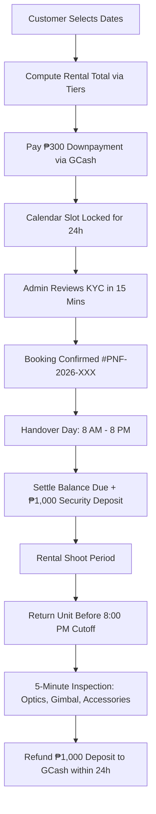

# PackAndFilm — Master Source of Truth & System Specification
**Version:** October 2026 (Production Release v3.2)  
**Authoritative Business Reference:** Sourced from `Requirements.pdf`, `T&C.pdf`, `How to Book.pdf`, frontend configuration (`src/data/rentalConfig.ts`, `src/data/cameras.ts`), and backend Apps Script engine (`google-apps-script/Code.gs`).

---

## 1. Brand Identity & Operating Parameters

| Attribute | Specification |
|---|---|
| **Brand Name** | PackAndFilm |
| **Legal / Operating Name** | Pack and Film - Camera Rentals |
| **Tagline / Mission** | Aesthetic camera rentals for concerts, travel vlogs, and street photography across Metro Manila. |
| **Base Hub** | Pasig City, Metro Manila, Philippines |
| **Operating Hours** | **8:00 AM – 8:00 PM ONLY** (Strict cutoff for pickups, deliveries, and returns) |
| **Instagram Handle** | [@packandfilm.ph](https://www.instagram.com/packandfilm.ph/) |
| **Facebook Page** | [@Pack and Film](https://www.facebook.com/people/Pack-and-Film/61595302043810/) |
| **Facebook Admin Profile** | Pack and Film / PackAndFilm Camera Rentals |
| **Terms Version** | `v2026.10-Oct` (Enforced on all digital rental agreements) |

---

## 2. Camera Lineup, Specifications, Pricing & Inclusions

### 2.1 DJI Osmo Pocket 3 Standard Kit (`dji-pocket-3`)
* **Status**: Available Now (Flagship Active Unit)
* **Rating**: 4.98 ★ (180 verified reviews)
* **Core Specs**:
  * Flagship 1-inch CMOS Sensor
  * 4K/120fps slow-motion & 10-bit D-Log M color profile
  * Ultra-smooth 3-axis mechanical gimbal stabilization
  * 2.0" Rotatable OLED touchscreen with ActiveTrack 6.0
* **Pricing Tiers**:
  * **1 Day**: ₱450 / day
  * **2–3 Days**: ₱420 / day (*Weekend Tier*)
  * **4–5 Days**: ₱380 / day (*Extended Trip Tier*)
  * **6+ Days**: ₱350 / day (*Long-Term Value Tier*)
* **Security Deposit**: ₱1,000 (Refundable within 24h after return inspection)
* **Downpayment**: ₱300 (Credited toward total rental; non-refundable reservation fee)
* **8 Complete Kit Inclusions**:
  1. **DJI Osmo Pocket 3 Unit**: 1-inch sensor 4K gimbal camera with rotatable OLED screen.
  2. **128GB MicroSD Card**: SanDisk Extreme PRO V30 A2 4K-certified (200MB/s read, 4+ hrs 4K footage).
  3. **Dual OTG Card Reader**: Dual Lightning + USB-C plug-and-play adapter for instant iPhone/Android export.
  4. **Silicone Desktop Base**: Anti-slip desktop cradle for steady cafe talk-heads and timelapses.
  5. **Handle Extension Grip**: 1/4" threaded tripod screw base with USB-C passthrough.
  6. **Protective Hard Lens Cover**: Hard-shell clamp locking gimbal motor safely during transit.
  7. **Pastel Woven Wrist Strap**: Reinforced woven paracord with adjustable cinch toggle for concert safety.
  8. **Weatherproof Shock Organizer Case**: Sanitized, padded EVA travel case with custom compartments.

---

### 2.2 Canon PowerShot G7 X Mark III Creator Vlogging Kit (`canon-g7x-mark-iii`)
* **Status**: Available Now (Active Unit)
* **Rating**: 4.97 ★ (38 verified reviews)
* **Core Specs**:
  * 20.1MP 1.0-inch Stacked CMOS Sensor with DIGIC 8 processor
  * Fast f/1.8–2.8 4.2x Optical Zoom (24–100mm equivalent)
  * 4K 30p Uncropped Video Recording & vertical video support
  * 180° Flip-up 3.0" Touchscreen for iconic warm portrait skin tones
* **Pricing Tiers**:
  * **1 Day**: ₱500 / day
  * **2–3 Days**: ₱450 / day (*Weekend Tier*)
  * **4–5 Days**: ₱420 / day (*Extended Trip Tier*)
  * **6+ Days**: ₱400 / day (*Long-Term Value Tier*)
* **Security Deposit**: ₱1,000 (Refundable within 24h after return inspection)
* **Downpayment**: ₱300 (Credited toward total rental; non-refundable reservation fee)
* **11 Complete Kit Inclusions**:
  1. **Canon PowerShot G7 X Mark III Camera Body**: Main compact camera unit.
  2. **32GB High-Speed SD Card**: Class 10 UHS-I card certified for 4K video recording.
  3. **SD Card OTG Reader**: Dual Lightning & USB-C adapter for instant mobile transfer.
  4. **Dedicated Wall Battery Charger**: OEM Canon AC dock for fast charging.
  5. **Dual NB-13L Batteries**: Two batteries (Main + Spare, 1250mAh each) for zero power anxiety.
  6. **Reinforced Wrist Strap**: Quick-cinch lanyard preventing drops in crowded concert venues.
  7. **Protective Silicone Case**: Custom ergonomic shock-absorbing sleeve.
  8. **Protective Camera Skin**: Precision matte die-cut vinyl finish against minor scuffs.
  9. **Pre-installed Tempered Glass**: 9H optical screen protector over 3.0" flip display.
  10. **Soft Protective Camera Pouch**: Cushioned drawstring sleeve for personal handbag carry.
  11. **Weatherproof Padded Camera Bag**: Sanitized canvas travel bag with customizable dividers.

---

### 2.3 Fujifilm X100VI Digital Film Simulation Kit (`fujifilm-x100vi`)
* **Status**: Coming Soon (Catalog Preview)
* **Target Rating**: 5.0 ★
* **Core Specs**:
  * 40.2MP APS-C X-Trans CMOS 5 HR Sensor
  * 20 Built-in Film Simulation recipes (Classic Chrome, Reala Ace, Nostalgic Neg)
  * 6.0-Stop In-Body Image Stabilization (IBIS)
  * Fixed 23mm F2.0 MK II Lens with Hybrid Optical/Electronic Viewfinder
* **Projected Pricing Tiers**:
  * **1–2 Days**: ₱900 / day
  * **3–5 Days**: ₱850 / day
  * **6+ Days**: ₱800 / day
* **Security Deposit**: ₱3,000 (Meetup) / ₱5,000 (Courier)
* **8 Kit Inclusions**:
  1. **Fujifilm X100VI Camera Unit**
  2. **128GB UHS-II Extreme SD Card (300MB/s V90)**
  3. **Black Mist Filter (1/4 Diffusion)**
  4. **Lens Adapter Ring & Metal Square Hood**
  5. **Dual NP-W126S Batteries & Fast Dual USB-C Charger**
  6. **Premium Vintage Tan Leather Neck & Hand Strap**
  7. **High-Speed SD OTG Card Reader**
  8. **Custom Padded Canvas Camera Bag**

---

## 3. Financial Rules, Fees & Payment Structure



### 3.1 Financial Breakdown & Formulas
1. **Rental Total**:
   $$\text{Rental Total} = \text{Rental Days} \times \text{Applicable Tier Daily Rate}$$
2. **Meetup Handling Fee**:
   $$\text{Meetup Fee} = \text{₱200 if Handover Mode is Meetup, else ₱0}$$
3. **Downpayment Paid**:
   $$\text{Downpayment} = \text{₱300 (Credited toward total; non-refundable)}$$
4. **Remaining Balance Due upon Handover**:
   $$\text{Balance Due} = (\text{Rental Total} - \text{Downpayment}) + \text{Meetup Fee} + \text{Security Deposit}$$
5. **Security Deposit**:
   * **Active Units (Pocket 3, Canon G7 X)**: ₱1,000 flat.
   * Fully refunded via GCash within 24 hours after return inspection.
   * Covers unreturned accessories, deep cosmetic damage, or unpaid balances.

### 3.2 Penalties & Policies (from `T&C.pdf`)
* **Cancellation Policy**:
  * **Strictly NO cancellation** once booking is confirmed.
  * Cancellation results in forfeiture of ₱300 downpayment **PLUS a ₱500 cancellation penalty**.
  * All rental fees are non-refundable and non-transferable under any circumstance.
* **Late Return Policy**:
  * Operating cutoff is strictly **8:00 PM**.
  * **₱150 / hour late fee** begins automatically 30 minutes past agreed return time.
  * If more than **2 hours late**, fee converts to **1 full extra day's standard rental + ₱2,000 inconvenience fee**.
* **Logistics & Handover**:
  * **Meetup Hubs**: SM East Ortigas, Bridgetowne, Opus Mall ONLY. Requires ₱200 handling fee.
  * **Delivery**: Grab Express ONLY. Owner books the rider for both dispatch and return; renter shoulders 100% of delivery fees.

---

## 4. Customer KYC Verification & Exemption Rules (from `Requirements.pdf`)

### 4.1 Standard Renter KYC Checklist
1. **Primary & Secondary Government IDs**:
   * Two (2) valid government IDs (Front & Back).
   * At least one ID must display the renter's current residential address and signature.
2. **Handwritten Authorization Slip**:
   * Clean paper with current Date, 3 specimen signatures, and the exact statement:  
     `"For Pack and Film Camera Rental purposes only"`.
   * Photographed together with the 2 physical IDs.
3. **Selfie with IDs & Authorization Slip**:
   * Clear, unedited photo of renter holding both IDs and the signed slip next to their face.
4. **Proof of Address / Billing**:
   * Utility bill, bank statement, or at least two (2) online delivery receipts (Shopee, Lazada, TikTok) showing matching full name and delivery address.
   * If bill is under another household member, their valid government ID must be attached.
5. **Active Social Media Account**:
   * Main personal Instagram or Facebook profile. Locked, private, newly created, or dummy accounts are strictly rejected.
   * Minors must provide active parent/guardian profiles.
6. **Two (2) Reachable Emergency Contacts**:
   * Full legal names, active mobile numbers, valid ID photos, and FB/IG profile links.
   * Both contacts are notified during booking confirmation and must respond.
7. **Selfie Video Verification**:
   * 5-second video holding both IDs stating: Full Name, rental dates, camera unit, and rental purpose.
8. **Facebook Admin Verification**:
   * Friend request sent to official admin account `"PackAndFilm Camera Rentals"`.

### 4.2 Student Exemption Protocol
Enrolled students lacking a secondary government ID may substitute:
* Valid Student ID
* Current Certificate of Registration (COR / Enrollment Assessment)
* Parent / Legal Guardian Valid Government ID (Front & Back) + Guardian Contact Number

---

## 5. Technical Architecture & Data Model

### 5.1 Technology Stack
* **Frontend**: React 18, TypeScript, Vite, TailwindCSS (utility classes), Lucide React.
* **Backend Database & Storage**: Google Apps Script Web App (Serverless V8 runtime) linked to Google Sheets & private Google Drive.
* **Color Palette & Design Tokens**:
  * Primary Navy: `#1A1A2E` (Typography, heavy borders, dark CTAs)
  * Lavender Accent: `#C9B8F0` / Soft Lavender: `#EDE8FC` (Badges, glows, brand accents)
  * Soft Peach: `#F5C6A8` / Warm Cream: `#FEF0E7` (Highlight pills, ratings)
  * Fresh Mint: `#A8DBC8` / Soft Sage: `#E8F7F1` (Verified badges, status pills)
  * Off-White Surface: `#FAFAF7` / Neutral White: `#FFFFFF`

### 5.2 Google Sheets 27-Column Bookings Schema
The backend engine maps rows dynamically across 27 canonical columns:
1. `Booking Ref` (e.g., `#PNF-2026-849201`)
2. `Timestamp` (ISO Manila Time `yyyy-MM-dd HH:mm`)
3. `Customer Name`
4. `Contact Number`
5. `Social Media Handle`
6. `Camera Rented`
7. `Start Date` (`yyyy-MM-dd`)
8. `End Date` (`yyyy-MM-dd`)
9. `Rental Days`
10. `Handover Method` (Meetup / Grab Express)
11. `Address`
12. `Shoot Type` (Travel / Concert / Event / Street)
13. `Rental Total` (₱)
14. `Security Deposit` (₱)
15. `Downpayment Paid` (₱300)
16. `Balance Due` (₱)
17. `GCash Ref`
18. `Status` (`Deposit Paid` $\rightarrow$ `Confirmed` $\rightarrow$ `Active Rental` $\rightarrow$ `Completed`)
19. `Notes & Emergency Contacts`
20. `Customer Documents Folder` (Private Google Drive Folder URL)
21. `Primary ID URL`
22. `Secondary ID / Student COR URL`
23. `Auth Slip URL`
24. `Billing Proof URL`
25. `Selfie Video Verification URL`
26. `Payment Receipt URL`
27. `Parent / Guardian ID URL`

### 5.3 Financial & Refund Audit Ledger (`💸 Financial & Refund Audit`)
Dedicated immutable sheet tracking cash movements:
* `Record ID`, `Booking Ref`, `Customer Name`, `Category`, `Amount (₱)`, `Payment Channel`, `Channel Ref`, `Transaction Date`, `Disbursed By`, `Status`, `Receipt Link`, `Notes`.

---

## 6. Admin Roles, Security & Dispatch Operations

### 6.1 Admin Credentials & Rate Limiting
* **Partner 1 (Lead Operations)**: Username `partner1`, SHA-256 hashed passkey.
* **Partner 2 (Equipment Manager)**: Username `partner2`, SHA-256 hashed passkey.
* **Session Management**: Server-side UUID token cached via `CacheService` (4-hour TTL).
* **Brute-Force Guard**: 5 consecutive failed login attempts locks out access for 15 minutes.
* **Zero Client Exposure**: No plaintext passwords or sensitive credentials stored in client code.

### 6.2 4-Step Operational Workflow
```
[Step 1: Deposit Paid]
       │
       ▼ (Admin reviews KYC documents, selfie video, and emergency contacts)
[Step 2: Confirmed]
       │
       ▼ (Gear released at SM East/Bridgetowne/Opus or dispatched via Grab Express; remaining balance collected)
[Step 3: Active Rental]
       │
       ▼ (Equipment returned before 8:00 PM; 5-min inspection completed; ₱1,000 deposit refunded via GCash)
[Step 4: Completed]
```

### 6.3 Customer Dispatch Messaging Templates (FB & IG)
1. **Handover Confirmation Message**:
   * Populates: Customer name, camera unit, dates, meetup hub or delivery address, remaining balance due, booking ref, physical ID reminder, and 3-minute physical inspection advisory.
2. **8:00 PM Return Reminder**:
   * Populates: Customer name, camera unit, return date, 8:00 PM cutoff, full gear checklist (camera, SD card, OTG reader, cables, cases), and GCash security deposit refund inspection procedure.
3. **Deposit Refunded Confirmation**:
   * Populates: Customer name, camera model, booking ref, verified return status, and ₱1,000 GCash confirmation.
   * **Security Rule**: Locked until the booking is marked as `Completed` in Step 4 to prevent premature or erroneous refund claims.
