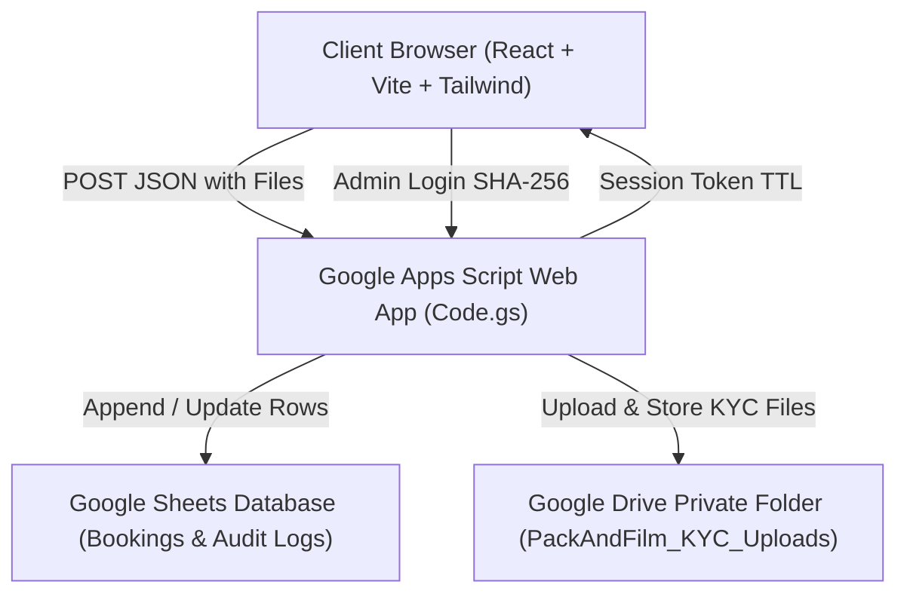
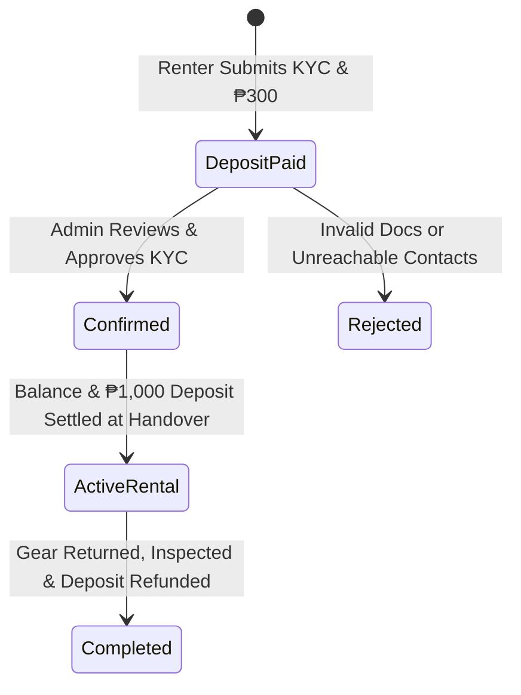

# PackAndFilm — Comprehensive Source of Truth (SSOT)

> **Last Updated:** October 2026  
> **Repository:** `Trncluis/PackAndFilm`  
> **Brand:** PackAndFilm (Pack and Film - Camera Rentals)  
> **Operational Base:** Pasig City, Metro Manila, Philippines  

---

## 1. Brand Identity & Operational Parameters

* **Legal & Display Name:** Pack and Film - Camera Rentals (`PackAndFilm`)
* **Tagline:** Aesthetic Camera Rentals in Metro Manila
* **Operating Hours:** Strictly **8:00 AM – 8:00 PM ONLY** (all handovers, meetups, deliveries, and returns must fall within this window)
* **Social Media & Customer Channels:**
  * **Instagram:** [@packandfilm.ph](https://www.instagram.com/packandfilm.ph/)
  * **Facebook Page:** [Pack and Film Facebook](https://www.facebook.com/people/Pack-and-Film/61595302043810/)
  * **Admin Account:** `Pack and Film` (for Facebook verification and friend requests)
* **Design System & Palette:**
  * Backgrounds: Warm Paper `#FAFAF7`, Soft Lilac `#EDE8FC`, Soft Peach `#FEF0E7`, Mint `#E8F7F1`
  * Primary Text & Outlines: Deep Ink `#1A1A2E` (2px borders, brutalist shadow styling `[4px_4px_0px_#1A1A2E]`)
  * Accent Colors: Lavender `#C9B8F0`, Coral `#F5C6A8`, Sage `#A8DBC8`, Deep Purple `#553C9A`
  * Typography: Plus Jakarta Sans / Inter, heavy black weights (800/900) for headers

---

## 2. Technical Architecture & Technology Stack



| Layer | Technology | Key Files / Configuration |
|---|---|---|
| **Frontend Framework** | React 18 + TypeScript + Vite | `src/App.tsx`, `vite.config.ts` |
| **Styling & Icons** | Tailwind CSS + Lucide React | `src/index.css`, `tailwind.config.js` |
| **Data Configuration** | TypeScript SSOT Modules | `src/data/cameras.ts`, `src/data/rentalConfig.ts` |
| **Admin Operations** | Custom Stateful SPA Drawer | `src/components/AdminDashboard.tsx` |
| **Backend API** | Google Apps Script (V3.2 Production) | `google-apps-script/Code.gs`, `Dashboard.gs` |
| **Database** | Google Sheets | Sheet tabs: `Bookings`, `AuditLogs`, `Archive` |
| **Document Storage** | Google Drive (Restricted Service Account) | Root folder: `PackAndFilm_KYC_Uploads` |
| **Hosting Platform** | Vercel (Production) | Linked to GitHub `main` branch |

---

## 3. Camera Lineup, Specs & Bag Inclusions
*(Note: Full kit inclusions and accessories are accessible directly via the **"Kit Inclusions & Accessories"** modal button on each camera listing card in `#catalog`, replacing the previous standalone 8-card section for a cleaner, conversion-focused page flow).*

### 3.1. DJI Osmo Pocket 3 Standard Kit
* **Status:** Available Now (Active Inventory)
* **Hardware Specs:** 1-inch CMOS Sensor, 4K/120fps video, 3-Axis Mechanical Gimbal, 2-inch Rotatable OLED Screen, ActiveTrack 6.0, 10-bit D-Log M
* **Pricing Tiers:**
  * **1 Day:** ₱450 / day
  * **2–3 Days:** ₱420 / day (Weekend Tier)
  * **4–5 Days:** ₱380 / day (Extended Trip)
  * **6+ Days:** ₱350 / day (Long-Term Value)
* **Security Deposit:** ₱1,000 (Refundable)
* **Included Kit Bag Items (8 Items):**
  1. DJI Osmo Pocket 3 Unit
  2. 128GB MicroSD Card (SanDisk Extreme PRO V30 A2)
  3. Dual OTG Card Reader (Lightning + Type-C for direct phone export)
  4. Silicone Desktop Base
  5. Handle Extension Grip (with 1/4" tripod thread)
  6. Protective Hard Lens Cover
  7. Pastel Woven Wrist Strap
  8. Weatherproof Shock Organizer Case

### 3.2. Canon PowerShot G7 X Mark III Creator Kit
* **Status:** Available Now (Active Inventory)
* **Hardware Specs:** 20.1MP 1.0-inch Stacked CMOS Sensor, 4.2x f/1.8–2.8 Zoom (24–100mm), 4K 30p Uncropped, 180° Flip-Up Touchscreen, DIGIC 8
* **Pricing Tiers:**
  * **1 Day:** ₱500 / day
  * **2–3 Days:** ₱450 / day
  * **4–5 Days:** ₱420 / day
  * **6+ Days:** ₱400 / day
* **Security Deposit:** ₱1,000 (Refundable)
* **Included Kit Bag Items (11 Items):**
  1. Canon PowerShot G7 X Mark III Body
  2. 32GB High-Speed SD Card
  3. Dual Lightning + Type-C OTG SD Card Reader
  4. Dedicated AC Wall Battery Charger
  5. Dual NB-13L Batteries (Main + Extra Battery)
  6. Reinforced Paracord Wrist Strap
  7. Protective Silicone Case
  8. Protective Matte Camera Skin
  9. Pre-installed 9H Tempered Glass Screen Protector
  10. Soft Protective Drawstring Pouch
  11. Weatherproof Padded Organizer Camera Bag

### 3.3. KODAK PIXPRO FZ55 Digital Camera
* **Status:** Coming Soon (Planned Lineup • Preview Only)
* **Hardware Specs:** 16MP 1/2.3" CMOS Sensor, 5x Optical Zoom (28–140mm equivalent), 1080p Full HD Video, 2.7" LCD Screen, Rechargeable Li-ion LB-012 battery
* **Target Rates:** ₱--- / day (Target • TBA upon acquisition)
* **Security Deposit:** TBA (₱---)

---

## 4. Financial Structure, Fees & Policies

| Fee Type | Amount | Rule & Policy |
|---|---|---|
| **Reservation Downpayment** | **₱300** | Required within 24 hours of inquiry to lock calendar dates. **Credited directly toward total rental fee** (not an extra charge). Strictly non-refundable. |
| **Refundable Security Deposit** | **₱1,000** | Required for all active units before gear release. Refunded via GCash within **24 hours** after unit return and completed gear inspection. |
| **Meetup Handling Fee** | **₱200** | Charged per transaction for physical meetups at designated hubs. |
| **Delivery Fee** | Shouldered by Renter | **Grab Express ONLY**. The owner books the rider for both dispatch release and return. |
| **Cancellation Penalty** | **₱500** | Strictly NO cancellations once confirmed. Forfeits the ₱300 reservation fee plus a ₱500 penalty. |
| **Late Return Fee (Hourly)** | **₱150 / hr** | Charged automatically starting **30 minutes** after agreed return time. |
| **Late Return (> 2 Hours)** | **1 Extra Day + ₱2,000** | If returned > 2 hours late, fee converts to 1 full standard day rental + ₱2,000 disruption penalty. |

### Handover Hub Locations
1. **SM East Ortigas**
2. **Bridgetowne (Pasig/Quezon City)**
3. **Opus Mall (Bridgetowne)**
4. **Grab Express Delivery** (Door-to-door across Metro Manila)

---

## 5. Customer Booking & KYC Verification Process

### Step-by-Step Renter Journey
1. **Step 1: Camera & Dates Selection** — Customer selects camera, pickup date, and return date; interactive calendar prevents overlapping bookings.
2. **Step 2: Handover Preference** — Meetup hub selection (₱200 fee) or Grab Express Delivery address.
3. **Step 3: Identification & KYC Documents** — Customer uploads:
   * Two (2) Valid Government IDs (front & back).
   * Handwritten Authorization Slip with date, 3 specimen signatures, and the exact text: *"For Pack and Film Camera Rental purposes only"*.
   * Selfie holding IDs and handwritten slip.
   * Proof of Billing or two (2) online delivery receipts (Shopee/Lazada/TikTok) matching delivery address.
   * 5-second Selfie Video holding IDs stating rental details.
   * Active personal social media account (locked/dummy accounts rejected).
   * Two (2) emergency contacts with names, numbers, valid IDs, and relationship.
   * *Student Exemption:* Valid Student ID + Certificate of Registration (COR) + Parent/Guardian Government ID.
4. **Step 4: Terms & Conditions Agreement** — Mandatory electronic checkbox accepting terms version `v2026.10-Oct`.
5. **Step 5: ₱300 Downpayment Settlement** — GCash transfer, reference number entry, and receipt screenshot upload.
6. **Step 6: Confirmation Reference** — Generation of official booking reference `#PNF-2026-XXXXXX` and status tracking.

---

## 6. Admin Security & Operational Workflow

### Dual-Partner Role Configuration
* **Partner 1:** `partner1` (Full Admin Privileges)
* **Partner 2:** `partner2` (Full Admin Privileges)
* **Authentication Method:** SHA-256 client-side and server-side passkey verification.
* **Brute-Force Protection:** IP & account rate-limiting; temporary lockout after 5 consecutive failed attempts.
* **Session Lifecycle:** Stateful token stored in `sessionStorage` with 12-hour TTL managed by Apps Script `CacheService`.

### 4-Stage Booking Lifecycle


1. **Deposit Paid (KYC Pending Review):** Downpayment received, KYC uploaded, awaiting admin document inspection.
2. **Confirmed:** All documents inspected, emergency contacts verified, booking locked on calendar.
3. **Active Rental:** Unit released, remaining rental balance and ₱1,000 deposit settled.
4. **Completed:** Equipment returned in order, 5-minute technical inspection passed, ₱1,000 deposit returned via GCash.

---

## 7. Google Sheets Database Schema (Columns 1–25)

The backend `Code.gs` utilizes dynamic header resolution and enforces the following 25-column structure on the `Bookings` sheet:

| Col # | Header Name | Description | Example / Allowed Values |
|---|---|---|---|
| **1** | `Timestamp` | Submission ISO timestamp | `2026-10-26T14:30:00.000Z` |
| **2** | `Booking Reference` | Unique reference code | `PNF-2026-924831` |
| **3** | `Customer Name` | Primary renter's full name | `Maria Santos` |
| **4** | `Contact Number` | Active Philippine mobile # | `09171234567` |
| **5** | `Social Media Handle` | Primary FB/IG profile | `@mariasantos.ph` |
| **6** | `Camera Rented` | Camera model display name | `DJI Osmo Pocket 3 Standard Kit` |
| **7** | `Start Date` | Handover start date | `YYYY-MM-DD` |
| **8** | `End Date` | Return date | `YYYY-MM-DD` |
| **9** | `Rental Days` | Computed rental duration | `3` |
| **10** | `Handover Method` | Meetup location or Grab | `Meetup (SM East Ortigas - ₱200 Fee)` |
| **11** | `Delivery Address` | Destination or meetup hub | `SM East Ortigas / Pasig` |
| **12** | `Shoot Type` | Rental intent/purpose | `Travel / Vacation Vlogging` |
| **13** | `Rental Total` | Computed rental rate | `₱1,260` |
| **14** | `Security Deposit` | Refundable deposit | `₱1,000` |
| **15** | `Meetup Handling Fee` | Meetup surcharge | `₱200` |
| **16** | `Downpayment Paid` | Credited reservation fee | `₱300` |
| **17** | `Balance Due` | Remaining due on handover | `₱2,160` |
| **18** | `GCash Reference Number`| Renter's payment ref # | `100234567890` |
| **19** | `Status` | Current operational state | `Deposit Paid`, `Confirmed`, `Active Rental`, `Completed` |
| **20** | `Notes` | Internal notes & contacts | `Emergency: Juan Santos (0918...)` |
| **21** | `Customer Documents Folder`| Private Google Drive URL | `https://drive.google.com/drive/folders/...` |
| **22** | `Terms Accepted` | Digital contract acceptance | `Yes` |
| **23** | `Terms Version` | Active policy revision | `v2026.10-Oct` |
| **24** | `Terms Accepted At` | Legal agreement timestamp | `2026-10-26T14:30:00.000Z` |
| **25** | `Action Timestamp` | Last admin status update | `2026-10-26T15:00:00.000Z` |

---

## 8. Google Drive Storage Architecture

* **Root Storage Folder:** `PackAndFilm_KYC_Uploads` (Restricted Google Drive directory).
* **Per-Booking Isolation:** Every booking creates exactly **ONE** dedicated folder named:
  `[REF #] Customer Name - Camera Model (YYYY-MM-DD)`
* **File Naming Standard:**
  * `01_ID1_Front_[Ref].jpg`
  * `02_ID1_Back_[Ref].jpg`
  * `03_ID2_Front_[Ref].jpg`
  * `04_ID2_Back_[Ref].jpg`
  * `05_Handwritten_Slip_[Ref].jpg`
  * `06_Selfie_With_IDs_[Ref].jpg`
  * `07_Address_Billing_Proof_[Ref].jpg`
  * `08_Selfie_Video_[Ref].mp4`
  * `09_Payment_Receipt_[Ref].jpg`
  * `10_Emergency_Contact_ID_[Ref].jpg`

---

## 9. Dispatch & Operations Message Templates

Templates available directly inside the Admin KYC Verification Drawer for fast copy-pasting to Facebook Messenger, Instagram DM, Viber, or SMS:

### Template 1: Handover Confirmation
```text
Hi [Customer Name]! ✨ This is PackAndFilm confirming your upcoming camera rental details:

📸 Camera Model: [Camera Model]
🗓️ Confirmed Rental Dates: [Start Date] to [End Date] ([Days] day/s)
📍 Handover Location: [Meetup Hub / Delivery Address]
💰 Remaining Balance Due Upon Handover: ₱[Balance Due] (Includes remaining rental balance + ₱1,000 refundable security deposit)
🔖 Booking Reference: [Booking Ref]

📌 Handover Reminders:
• Please bring the original physical IDs submitted during KYC verification.
• We will conduct a quick 3-minute physical inspection together to check all gear and accessories.
• Operating hours: 8:00 AM – 8:00 PM.

Let us know your estimated arrival time! Excited for your shoot! 💖📸
```

### Template 2: Return Reminder (Cutoff 8:00 PM)
```text
Hi [Customer Name]! Hope you had an amazing shoot with the [Camera Model]! 📸✨

Friendly reminder that your camera rental is scheduled for return today:
🗓️ Return Date: [End Date]
⏰ Return Cutoff: 8:00 PM
📍 Return Location: [Meetup Hub / Delivery Address]

🎒 Return Checklist:
• Camera unit and battery
• High-speed SD / MicroSD card & OTG card reader
• All included cables, mounts, wrist strap, and silicone/hard case
• Padded organizer travel bag

💳 Security Deposit Refund Procedure:
Upon receiving the unit, our team will perform a standard 5-minute gear inspection (checking lens optics, gimbal calibration, and accessory count). Once verified in order, your ₱1,000 refundable security deposit will be processed promptly via GCash.

Please update us with your ETA or courier tracking details when dispatching. Thank you for taking great care of our gear! 💖
```

### Template 3: Deposit Refunded Confirmation
*(Strictly guarded: Unlocked only when booking status is marked as `Completed`)*
```text
Hi [Customer Name]! 💖 Good news: gear inspection for your [Camera Model] rental (Ref: [Booking Ref]) is complete!

All equipment and inclusions were inspected and received in excellent condition! ✨

✅ Security Deposit Refunded: ₱1,000 (GCash: [Contact/Ref])
📱 Status: Verified Returned & Completed

Thank you so much for renting with PackAndFilm! We'd love to see your shots—feel free to tag us on Instagram @packandfilm.ph or on Facebook. Can't wait to have you again! 📸🎉
```

---

## 10. Environment Variables & Deployment Secrets

| Variable | Scope | Purpose |
|---|---|---|
| `VITE_APPS_SCRIPT_URL` | Frontend (`.env`) | Deployed Google Apps Script Web App URL (`exec` endpoint) |
| `SPREADSHEET_ID` | Backend (`Code.gs`) | Active Google Sheets Database ID |
| `KYC_ROOT_FOLDER_NAME` | Backend (`Code.gs`) | Target root directory name in Google Drive |
| `PARTNER1_HASH` | Backend / Config | SHA-256 digest for Partner 1 access |
| `PARTNER2_HASH` | Backend / Config | SHA-256 digest for Partner 2 access |

---

## 11. Booking Availability & Consecutive Turnover Rules

### 11.1. Core Conflict vs. Turnover Logic
* **Interval Model:** PackAndFilm bookings operate on daily rental dates (`YYYY-MM-DD`).
* **Consecutive Booking / Same-Day Turnover:**
  * When Customer A rents from `Oct 31` to `Nov 1` (returns on `Nov 1`), Customer B is permitted to book `Nov 1` to `Nov 2` (picks up on `Nov 1`).
  * **Turnover Rule Definition:** A shared boundary date (`booked.endDate === requested.startDate` or `requested.endDate === booked.startDate`) is allowed **only if both reservations span at least 1 night** (`startDate < endDate`).
  * **Single-Day Booking Exception:** If a booking is single-day (`startDate === endDate`), the camera is reserved for the full operating day, so no same-day turnover is permitted on that date.
  * **True Overlaps:** Any rental overlapping by multiple days or internal days (e.g. requesting `Oct 31` to `Nov 2` when `Oct 31` to `Nov 1` is booked) remains strictly blocked as a collision.

### 11.2. Operational Schedule & Time-of-Day Handover Coordination
* **Limitation:** The database and booking forms store calendar dates (`YYYY-MM-DD`), not hourly timestamps.
* **Operating Window:** 8:00 AM – 8:00 PM strictly.
* **Turnover Coordination:**
  * On turnover days, Customer A returns the gear (recommended morning / early afternoon cutoff).
  * PackAndFilm operations performs a 15–30 minute standard inspection (lens clarity, sensor/optics check, gimbal test, battery recharge, accessory inventory, sanitized wiping).
  * Customer B receives the unit during afternoon/evening handover.
  * The frontend displays clear amber status notices informing renters of the same-day turnover schedule.

