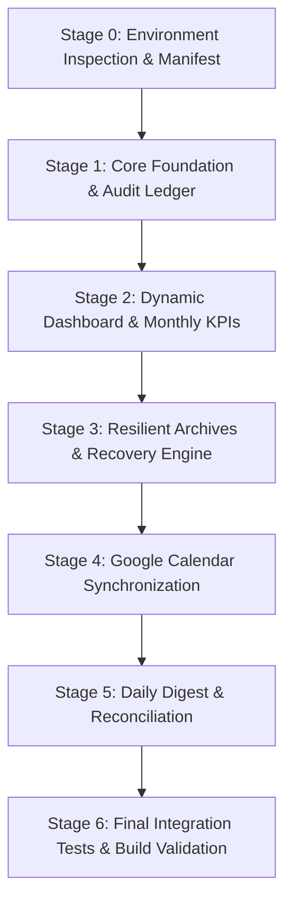

# Definitive Technical Specification & Implementation Architecture: PackAndFilm Monthly Reporting, Historical Archives, Financial Audit, and Google Calendar

---

## 1. Confirmed Existing-Project Facts & Environment Prerequisites

### A. Confirmed Codebase & Repository Facts
Following a comprehensive inspection of the local repository and Google Apps Script codebase (`google-apps-script/Code.gs`, `google-apps-script/Dashboard.gs`, `package.json`, and Vite/React frontend):

1. **Active Script Environment:**
   * Script file `google-apps-script/Code.gs` (1,229 lines) contains:
     * `doGet(e)`: Handles public availability queries reading `Calendar Sync` Columns A–F (indices 0–5) and protected `getAllBookings` using session tokens.
     * `doPost(e)`: Handles endpoints `adminLogin`, `adminLogout`, `getAllBookings`, `updateStatus`, `deleteBooking`, `clearAllBookings`, `uploadAdditionalDocuments`, and default public customer reservation submission.
     * Concurrency lock: Reservation submission uses `LockService.getScriptLock()` with a 30-second wait lock.
   * Script file `google-apps-script/Dashboard.gs` (483 lines) contains:
     * Brand color tokens: `LAVENDER = "#C9B8F0"`, `LAVENDER_TINT = "#F5F2FC"`, `PEACH = "#F5C6A8"`, `PEACH_TINT = "#FEF6F0"`, `INK = "#1A1A2E"`, `MUTED = "#6B6B8A"`, `BORDER_COLOR = "#E6E2F0"`, `PURPLE_ACCENT = "#553C9A"`.
     * `BOOKING_COLUMNS`: Standard 27-column header definition for `Bookings`.
     * Bounds guards: `ensureColumns(sheet, requiredCols)` and `ensureRows(sheet, requiredRows)`.
     * `formatAndBeautifyWorkbook()`: Builds `📊 Dashboard & Stats`, `Bookings`, `Calendar Sync`, and `Fleet Inventory`.
   * Frontend environment:
     * React 19 + TypeScript + Vite web app.
     * Zero customer-facing changes permitted: rental pricing, KYC rules, GCash instructions, and booking submission schemas remain untouched.

2. **Unresolved Environment Prerequisites (To be verified/provisioned in Google Workspace):**
   * **Manifest File (`appsscript.json`):** Must explicitly specify `"timeZone": "Asia/Manila"` and runtime `"V8"`. Currently missing in `google-apps-script/` and must be created.
   * **Spreadsheet Timezone:** Google Sheets Settings (File $\rightarrow$ Settings $\rightarrow$ Calculation) must be confirmed as `(GMT+08:00) Manila`.
   * **Dedicated Secondary Calendar:** Secondary calendar `PackAndFilm Rentals` must exist in Google Calendar. Its unique ID must be saved in Script Properties under `PACKANDFILM_CALENDAR_ID`.
   * **Calendar Permissions:** The executing account must have `Owner` or `Make changes to events` access on `PackAndFilm Rentals`.
   * **Admin Credentials:** Script properties `ADMIN_PARTNER1_HASH`, `ADMIN_PARTNER1_NAME`, `ADMIN_PARTNER2_HASH`, and `ADMIN_PARTNER2_NAME` store SHA-256 hashed passwords.

3. **Privacy and Data Protection Invariants:**
   * Secret values, admin passkeys, customer contact details, phone numbers, home addresses, and KYC documents must NEVER be printed to logs, exposed via unauthenticated endpoints, or embedded in Google Calendar event descriptions.

---

## 2. Preserved Sheet Schemas, Field Definitions, and Accounting Rules

### A. Single Source of Truth: `Bookings` Sheet (27 Columns Preserved)
The `Bookings` sheet remains immutable at exactly 27 columns. No columns will be added, removed, or reordered:
* Col 1 (`A`): `Booking Ref` (Unique identifier, e.g. `#PNF-2026-001`)
* Col 2 (`B`): `Timestamp` (Customer reservation submission timestamp — **never** treated as payment timestamp)
* Col 3 (`C`): `Customer Name`
* Col 4 (`D`): `Contact Number`
* Col 5 (`E`): `Social Media Handle`
* Col 6 (`F`): `Camera Rented`
* Col 7 (`G`): `Start Date` (`YYYY-MM-DD`, date-only string)
* Col 8 (`H`): `End Date` (`YYYY-MM-DD`, date-only string)
* Col 9 (`I`): `Rental Days` (Integer)
* Col 10 (`J`): `Handover Method`
* Col 11 (`K`): `Address / Hub`
* Col 12 (`L`): `Shoot Type`
* Col 13 (`M`): `Rental Total` (Contracted rental revenue, e.g. ₱1,350)
* Col 14 (`N`): `Security Deposit` (Refundable deposit contractually agreed, e.g. ₱1,000 or ₱2,500)
* Col 15 (`O`): `Downpayment Paid` (Reservation deposit, e.g. ₱300)
* Col 16 (`P`): `Balance Due` (Remaining handover balance)
* Col 17 (`Q`): `GCash Ref Number` (Customer-submitted reference)
* Col 18 (`R`): `Booking Status` (`Deposit Paid`, `Pending Verification`, `Confirmed`, `Active Rental`, `Completed`, `Rejected`, `Cancelled`)
* Col 19 (`S`): `Notes & Emergency Contacts`
* Col 20 (`T`): `Customer Documents Folder` (Private Google Drive folder URL)
* Cols 21–27 (`U`–`AA`): Direct URLs for customer KYC documents

---

### B. Compatibility Guard: `Calendar Sync` Sheet (Columns 1–6 Fixed, 7–13 Extended)
Columns 1–6 are actively read by `doGet` availability checks and written by `doPost`. They remain 100% backward-compatible:
* Col 1 (`A`): `Camera ID` (queried by `doGet` index 0)
* Col 2 (`B`): `Start Date` (queried by `doGet` index 1)
* Col 3 (`C`): `End Date` (queried by `doGet` index 2)
* Col 4 (`D`): `Customer Tag` (queried by `doGet` index 3)
* Col 5 (`E`): `Booking Ref` (queried by `doGet` index 4)
* Col 6 (`F`): `Status` (queried by `doGet` index 5)

**Non-Breaking Backend Extensions (Columns 7 to 13):**
* Col 7 (`G`): `Pickup Event ID` (Google Calendar event ID for rental dispatch)
* Col 8 (`H`): `Return Event ID` (Google Calendar event ID for rental return)
* Col 9 (`I`): `Confirmed At` (Structured ISO timestamp of booking confirmation milestone — **never** used as payment proof)
* Col 10 (`J`): `Handover At` (Structured ISO timestamp of equipment dispatch)
* Col 11 (`K`): `Completed At` (Structured ISO timestamp of return completion)
* Col 12 (`L`): `Cancelled At` (Structured ISO timestamp of cancellation)
* Col 13 (`M`): `Calendar Sync Status & Audit Log` (Carries milestone transition history and sync logs)

---

### C. Dedicated Audit Ledger: `💸 Financial & Refund Audit` (13 Standard Columns)
To record verified cash movements without mutating the 27-column `Bookings` schema:
* Col 1 (`A`): `Audit Record ID` (Unique sequential ID, e.g. `AUD-2026-0001`)
* Col 2 (`B`): `Booking Ref` (Links to `Bookings` Col 1)
* Col 3 (`C`): `Customer Name`
* Col 4 (`D`): `Transaction Category` (`Downpayment Verification`, `Handover Balance Payment`, `Security Deposit Receipt`, `Security Deposit Refund`, `Damage Deduction`, `Deposit Forfeiture`, `Retained Reservation Fee`, `Assessed Cancellation Penalty`, `Late Penalty Settlement`, `Ledger Correction`, `Goodwill Waiver`)
* Col 5 (`E`): `Amount` (PHP numeric value)
* Col 6 (`F`): `Customer Payment Timestamp` (Actual timestamp customer sent funds from receipt proof; blank if unverified or outgoing)
* Col 7 (`G`): `Payment Verification Timestamp` (Timestamp when admin verified funds in business GCash wallet)
* Col 8 (`H`): `Booking Confirmation Timestamp` (`Confirmed At` milestone; non-payment milestone reference)
* Col 9 (`I`): `Disbursement Timestamp` (Timestamp outgoing funds left GCash; blank for incoming payments)
* Col 10 (`J`): `GCash / Channel Reference` (Customer incoming ref or admin outgoing payout ref)
* Col 11 (`K`): `Verification Status` (`Verified Received`, `Verified Disbursed`, `Pending Verification`, `Unverified Claim`, `Forfeited / Retained`, `Waived`)
* Col 12 (`L`): `Auditing Admin` (Partner username and display name)
* Col 13 (`M`): `Audit Notes & Receipt URL` (Inspection details, deduction breakdown, or waiver rationale)

---

### D. Five Distinct Timestamp and Date Concepts in Financial Accounting
To eliminate misreporting and conflation across financial records:
1. **Customer Payment Timestamp (`💸 Financial & Refund Audit` Col 6):** The actual date and time funds left the customer's wallet, extracted directly from payment receipt evidence. If unextracted or unverified, this field is left **BLANK** (null). It is **never** populated with the reservation submission timestamp.
2. **Payment Verification Timestamp (`💸 Financial & Refund Audit` Col 7):** The exact date and time an administrator verified that funds cleared into the official PackAndFilm GCash business wallet.
3. **Booking Confirmation Timestamp (`Confirmed At` in `Calendar Sync` Col 9 & Audit Col 8):** The operational timestamp when admin approved customer KYC documents and confirmed the reservation slot. This is an operational workflow milestone and is **never** accepted as evidence of cash payment.
4. **Disbursement Timestamp (`💸 Financial & Refund Audit` Col 9):** The exact date and time an outgoing refund, payout, or reimbursement left the business GCash wallet. Populated **only** for outgoing cash transactions; left **BLANK** for incoming receipts.
5. **Reporting-Date Proxy:** When the exact customer payment timestamp is unavailable on historical or unverified bookings, financial summaries explicitly label the reporting basis as a proxy (e.g. `Date Basis: Payment Verification Date` or `Date Basis: Reservation Submission Date [Proxy]`).

---

### E. Financial Realization & Accounting Classification Rules
Every financial metric displayed on reports or dashboards must adhere to strict realization categories:

| KPI / Metric | Source Fields & Filter Criteria | Date Basis | Verification Requirement | Accounting Classification |
| :--- | :--- | :--- | :--- | :--- |
| **Verified Downpayments** | `💸 Financial & Refund Audit` where Category = `Downpayment Verification` AND Status = `Verified Received`. | `Payment Verification Timestamp` (or verified receipt date). | Wallet balance verification by admin. | **VERIFIED CASH (REVENUE)** |
| **Unverified Downpayment Claims** | `Bookings` where Status IN (`Deposit Paid`, `Pending Verification`) without matching `Verified Received` audit record. | `Timestamp` (submission date proxy). | None (customer claim only). | **UNVERIFIED CLAIM (PENDING)** |
| **Inferred Handover Balance** | `Bookings` where Status IN (`Active Rental`, `Completed`) minus verified downpayments. | `Handover At` or `Start Date` (proxy). | Dispatch inspection per operating policy (no integrated POS/bank feed). | **INFERRED REVENUE (SETTLED AT HANDOVER)** |
| **Contracted Rental Receivables** | `Bookings` where Status = `Confirmed`, balance due ($\text{Rental Total} - ₱300$). | `Start Date` (future contract date). | Contracted booking confirmed; funds due upon handover. | **CONTRACTED RECEIVABLE** |
| **Active Security Deposits in Custody** | $\sum \text{Verified Deposit Receipts} - \sum \text{Verified Deposit Refunds} - \sum \text{Damage Deductions / Forfeitures}$ from `💸 Financial & Refund Audit`. | `Payment Verification Timestamp`. | Ledger-verified cash movements. | **CUSTODIAL LIABILITY (NOT REVENUE)** |
| **Deposits Pending Refund Processing** | Bookings with Status = `Completed` that have verified deposit receipts but NO recorded disbursement in `💸 Financial & Refund Audit`. | `Completed At` (return date). | Return inspection complete; payout pending execution or logging. | **PENDING SETTLEMENT (LIABILITY)** |
| **Verified Deposit Refunds Dispatched** | `💸 Financial & Refund Audit` where Category = `Security Deposit Refund` AND Status = `Verified Disbursed`. | `Disbursement Timestamp`. | Admin outgoing GCash ref + disbursement timestamp. | **VERIFIED DISBURSEMENT** |
| **Assessed Damage & Cancellation Revenue** | `💸 Financial & Refund Audit` where Category IN (`Damage Deduction`, `Deposit Forfeiture`, `Retained Reservation Fee`, `Assessed Cancellation Penalty`). | Verification / Assessment Timestamp. | Documented deduction with admin audit note and inspection proof. | **FEE REVENUE / EXPENSE OFFSET** |

* **Deposit Custody Invariant:** Refundable security deposits are strictly custodial liabilities held in trust. They are **never** counted as rental revenue.
* **No Presumed Deposit Amounts:** The system **never assumes** every completed booking has a verified ₱1,000 deposit or a full ₱1,000 refund liability. Custody is calculated solely from verified receipts minus disbursements and documented deductions.

---

## 3. Resilient Archive Versioning, Deterministic Fingerprinting, and Recovery

### A. Universal Concurrency Locking & Safe Release
All archive operations (`generateMonthlyArchive`, `adminReviseMonthlyArchive`, `recoverMonthlyArchive`) must acquire `LockService.getScriptLock()` with a 30-second timeout. All locks are strictly enclosed in a `try ... finally` block:
```javascript
const lock = LockService.getScriptLock();
if (!lock.tryLock(30000)) {
  throw new Error("Another archive operation is currently in progress. Please retry in a few moments.");
}
try {
  // Execute archive generation, revision, or recovery
} finally {
  try {
    lock.releaseLock();
  } catch (lockErr) {
    Logger.log("Lock release warning: " + lockErr.toString());
  }
}
```

---

### B. Unified Version-Numbering and Occupied Tab Name Resolution
When archiving month `YYYY-MM`:
1. **Initial Finalization:** Creates canonical tab `Archive_YYYY-MM` stamped with `STATUS: FINALIZED (v1)`.
2. **Revisions (`adminReviseMonthlyArchive`):**
   * Inspects canonical `Archive_YYYY-MM` header in cell `B2` to establish current active version $v_{current}$ (e.g. `v1`).
   * Computes prior snapshot tab name: `Archive_YYYY-MM_v{v_{current}}`.
   * **Occupied Tab Name Guard:** If a tab named `Archive_YYYY-MM_v{v_{current}}` already exists, increments counter until an unoccupied tab name is found.
   * Renames current canonical `Archive_YYYY-MM` $\rightarrow$ `Archive_YYYY-MM_v{v_{current}}`.
   * Promotes new validated staging tab $\rightarrow$ canonical `Archive_YYYY-MM` stamped with `STATUS: REVISED (v{v_{new}})`.
   * If version history cannot be safely established (e.g. unparseable header or conflicting metadata), execution **halts immediately** and requires admin review.

---

### C. Deterministic Content Fingerprint Serialization
The archive content fingerprint must be deterministic, detecting any meaningful change in booking records, financial figures, or rental dates. The SHA-256 digest is computed from sorted rows converted to uppercase hexadecimal:

```javascript
/**
 * Computes deterministic SHA-256 fingerprint for archived booking rows.
 * Detects any changes to references, status, financial amounts, or dates.
 */
function computeDeterministicArchiveFingerprint(rows) {
  if (!rows || rows.length === 0) {
    // Deterministic fingerprint for a valid zero-booking month
    return "0000000000000000000000000000000000000000000000000000000000000000";
  }
  
  // Sort deterministically by Booking Ref (index 0)
  const sorted = rows.slice().sort((a, b) => String(a[0]).localeCompare(String(b[0])));
  
  const serializedLines = sorted.map(r => [
    String(r[0] || "").trim(),                   // Col 1: Booking Ref
    String(r[17] || "").trim(),                  // Col 18: Status
    Number(r[12] || 0).toFixed(2),               // Col 13: Rental Total
    Number(r[13] || 0).toFixed(2),               // Col 14: Security Deposit
    Number(r[14] || 0).toFixed(2),               // Col 15: Downpayment Paid
    Number(r[15] || 0).toFixed(2),               // Col 16: Balance Due
    String(r[6] || "").trim(),                   // Col 7: Start Date
    String(r[7] || "").trim()                    // Col 8: End Date
  ].join("|"));
  
  const payload = serializedLines.join("\n");
  const rawDigest = Utilities.computeDigest(Utilities.DigestAlgorithm.SHA_256, payload, Utilities.Charset.UTF_8);
  
  let hex = "";
  for (let i = 0; i < rawDigest.length; i++) {
    let b = rawDigest[i];
    if (b < 0) b += 256;
    let s = b.toString(16);
    if (s.length === 1) s = "0" + s;
    hex += s;
  }
  return hex;
}
```

* **Illustrative Computed Example:**
  * Sample 3-row payload:
    ```
    #PNF-2026-001|Confirmed|1350.00|2500.00|300.00|3550.00|2026-10-14|2026-10-17
    #PNF-2026-002|Active Rental|1000.00|1000.00|300.00|1700.00|2026-10-21|2026-10-23
    #PNF-2026-003|Deposit Paid|1000.00|1000.00|300.00|1700.00|2026-10-24|2026-10-26
    ```
  * Deterministic SHA-256 Digest: `36a8d795b6c507119ce0743bdf31fc61a4f02fa10e75a74e5e490578667c2688`
  * (Never use empty-string hash `e3b0c44298fc1c149afbf4c8996fb92427ae41e4649b934ca495991b7852b855` as an example).

---

### D. Snapshot Validation & Evidence-Based Recovery Engine (`recoverMonthlyArchive`)
To validate and recover archives without false rejections:
1. **Validation Criteria for Archive Snapshots:**
   * **Structural Integrity:** Tab exists, frozen row = 1, required 27 headers match in Row 1.
   * **Header Metadata:** Cell `B2` contains a valid status (`FINALIZED` or `REVISED`).
   * **Data Row Integrity:** Row count $\ge 1$ (Row 1 headers + $N$ data rows, where $N \ge 0$).
   * **Zero-Booking Support:** A valid month with 0 bookings and ₱0 revenue is fully supported and recoverable. Booking count $= 0$ and revenue $= 0$ must not cause validation failure.
   * **Formula Cleanliness:** Zero formula errors (`#REF!`, `#VALUE!`, `#NAME?`).
   * **Content Fingerprint:** If an operation state record exists in `PropertiesService`, compares computed fingerprint against stored fingerprint.
2. **Recovery Decision Tree:**
   * **Staging Tab Found (`Archive_YYYY-MM_staging`):**
     * If canonical `Archive_YYYY-MM` is missing or corrupted, and staging passes validation: Promotes staging to canonical.
     * If canonical `Archive_YYYY-MM` is already valid and finalized: Safely deletes orphaned staging tab.
     * If fingerprint or schema conflicts: Leaves staging tab intact, logs `RECOVERY_AMBIGUOUS_STAGING_RETAINED`, and alerts admin.
   * **Corrupted Canonical Tab:**
     * Inspects historical snapshots `Archive_YYYY-MM_v{N}` in descending order.
     * Restores the highest valid verified snapshot.
     * If no valid snapshot or staging exists, logs `NEEDS_ADMIN_REVIEW` and halts.

---

## 4. Google Calendar Two-Way Synchronization, Ownership Verification, and Deletion Rules

### A. Supported Apps Script API & Multi-Factor Ownership Protocol
Google Apps Script native `CalendarApp` and `CalendarEvent` methods are used:
* Calendar access: `CalendarApp.getCalendarById(calendarId)`.
* Event tags: `event.setTag(key, value)` and `event.getTag(key)` (fully supported native methods).
* Reminders: `event.addPopupReminder(minutes)` and `event.addEmailReminder(minutes)`.
* Description: `event.setDescription(text)`.
* Deletion: `event.deleteEvent()`.

**Programmatic Ownership Verification (All 5 Checks Required):**
1. **Calendar Scope:** Event exists strictly in secondary calendar `PACKANDFILM_CALENDAR_ID`.
2. **Native Event Tags:**
   * `event.getTag("system") === "PackAndFilm"`
   * `event.getTag("bookingRef") === targetRef`
   * `event.getTag("eventType") === "pickup"` or `"return"`
3. **Saved Event IDs in Calendar Sync:** Event ID matches Col 7 (`Pickup Event ID`) or Col 8 (`Return Event ID`).
4. **Description Marker Footer:**
   `[SYSTEM:PackAndFilm | REF:#PNF-2026-XXXX | TYPE:pickup]` or `...| TYPE:return]`.
5. **Standardized Title:** `Rental Start | #PNF-2026-XXXX` or `Camera Return | #PNF-2026-XXXX`.

---

### B. Three-Tier Calendar Action Separation

#### Tier 1: Routine Cancellation (Non-Destructive Title Prefix)
* **Trigger:** Booking status changes to `Cancelled` or `Rejected`.
* **Action:**
  1. Retrieves event by saved ID and verifies ownership tags.
  2. Updates title by prepending `[CANCELLED]`:
     * `[CANCELLED] Rental Start | #PNF-2026-XXXX`
     * `[CANCELLED] Camera Return | #PNF-2026-XXXX`
  3. Clears all active reminders: `event.removeAllReminders()`.
  4. **Strict Safety Invariant:** Routine cancellation **NEVER deletes the event**. The event remains permanently on the calendar as an operational audit record.

#### Tier 2: Uncertain Ownership Handling (Non-Invasive Observation)
* **Trigger:** An event on `PackAndFilm Rentals` lacks corroborating metadata, has mismatched booking reference, or description markers were modified.
* **Action:**
  1. **Zero Modification Policy:** The system **will not touch, edit, rename, or delete** the event.
  2. Discrepancy details are logged strictly to internal sheet `Calendar_Reconciliation_Log`.
  3. An alert is flagged on the admin dashboard for partner review.

#### Tier 3: Permanent Deletion (Explicit Administrative Purge)
* **Trigger:** Invoked **only** via explicit administrative function: `adminPurgeCancelledCalendarEvent(bookingRef)`.
* **Mandatory Prerequisites (ALL 6 Criteria Must Pass):**
  1. Event resides strictly in `PACKANDFILM_CALENDAR_ID`.
  2. Event ID matches `Pickup Event ID` or `Return Event ID` in `Calendar Sync`.
  3. Native tag `event.getTag("system") === "PackAndFilm"`.
  4. Native tag `event.getTag("bookingRef") === bookingRef`.
  5. Description contains exact regex match for `\[SYSTEM:PackAndFilm \| REF:` + bookingRef + ` \| TYPE:(pickup|return)\]`.
  6. Booking in `Bookings` sheet has status `Cancelled` or `Rejected`.
* If any single criterion fails, deletion aborts immediately without touching the event.

---

### C. Calendar Privacy Minimization & All-Day Event Specifications
To ensure customer data privacy, event descriptions strictly omit PII:
* **Excluded Data:** NO customer phone numbers, NO social media handles, NO home addresses, NO KYC documents, NO Drive URLs.
* **Permitted Operational Content:**
  * Booking Reference (`#PNF-2026-XXXX`)
  * Camera Model (`DJI Osmo Pocket 3 Standard Kit`)
  * Generic Handover Logistics Type (`Meetup (Pasig Hub)` or `Courier Dispatch`)
  * Operating Hours (`8:00 AM – 8:00 PM`)
  * Equipment inspection checklist
  * Machine-readable description marker footer (`[SYSTEM:PackAndFilm | ...]`)

**All-Day Event Alignment:**
Events are created strictly as all-day events using `calendar.createAllDayEvent()` on `Start Date` (dispatch) and `End Date` (return). Date objects are parsed at 12:00:00 PM in `Asia/Manila` to prevent timezone boundary drift.

---

### D. Empirical Calendar Reminder Behavior
* All-day event reminders (`addPopupReminder`, `addEmailReminder`) in Google Calendar evaluate relative to each user's default calendar notification settings for all-day events (typically 9:00 AM local time).
* Platform reality: Google Calendar does not guarantee exact-minute delivery for all-day notifications across mobile OS clients (due to battery optimization, sync frequencies, and client notification channels). The specification documents requested reminder intervals (24 hours prior) while noting platform delivery characteristics.

---

## 5. Daily Digest State Machine, Thread-Aware Reconciliation, and Recovery

### A. Cloud Execution Window & Trigger Configuration
* **Trigger Definition:**
  ```javascript
  ScriptApp.newTrigger("dailyRentalNotificationDigest")
    .timeBased()
    .atHour(7)
    .nearMinute(30)
    .everyDays(1)
    .inTimezone("Asia/Manila")
    .create();
  ```
* **Execution Reality:** Time-based triggers targeting 7:30 AM with `.nearMinute(30)` execute within a cloud scheduling window of approximately $\pm 15$ minutes (7:15 AM to 7:45 AM Manila time).

---

### B. Explicit Digest Delivery State Machine
The delivery state machine prevents duplicate notification emails:

```mermaid
stateDiagram-v2
    [*] --> IDLE
    IDLE --> PENDING: Scheduled trigger fires; write DIGEST_PENDING
    PENDING --> SENT: MailApp.sendEmail() succeeds; write DIGEST_SENT
    PENDING --> FAILED: MailApp throws error; write DIGEST_FAILED
    PENDING --> AMBIGUOUS: Lock expired (>30m) without SENT marker
    AMBIGUOUS --> SENT: Gmail search finds matching sent message
    AMBIGUOUS --> AMBIGUOUS_LOCKED: Gmail search inconclusive / API error
    AMBIGUOUS_LOCKED --> SENT: Admin manual verification confirms sent
    AMBIGUOUS_LOCKED --> PENDING: Admin manual trigger forces resend
    SENT --> [*]: Halts execution (No duplicates)
```



1. **Deterministic Digest Identifier:**
   * Each daily digest is assigned a unique identifier: `PNF-DIGEST-YYYY-MM-DD`.
   * Subject line: `PackAndFilm Daily Operational Digest [PNF-DIGEST-YYYY-MM-DD]`.
   * Body footer token: `<!-- DIGEST_ID: PNF-DIGEST-YYYY-MM-DD -->`.
2. **State Storage in `PropertiesService`:**
   * `DIGEST_PENDING_YYYY-MM-DD`: Timestamp of pre-send intent lock.
   * `DIGEST_SENT_YYYY-MM-DD`: Timestamp of verified send.
   * `DIGEST_FAILED_YYYY-MM-DD`: Error message if send failed.
   * `DIGEST_AMBIGUOUS_YYYY-MM-DD`: Timestamp when ambiguity detected.
3. **Execution Decision Logic:**
   * If `DIGEST_SENT_YYYY-MM-DD` exists $\rightarrow$ EXIT immediately.
   * If `DIGEST_PENDING_YYYY-MM-DD` is $< 30$ minutes old $\rightarrow$ EXIT (send currently in progress).
   * If `DIGEST_PENDING_YYYY-MM-DD` is $> 30$ minutes old, or state is `AMBIGUOUS`:
     * Queries Gmail Sent box: `GmailApp.search('subject:"[PNF-DIGEST-' + today + ']" in:sent')`.
     * Inspects messages within matching threads. If an email with exact subject and sent date matching today is found:
       * Updates state to `DIGEST_SENT_YYYY-MM-DD = timestamp`.
       * Logs reconciliation in `Digest_Execution_Log`.
       * **Exits without resending**.
     * If search returns 0 threads or throws an error (e.g. search indexing lag or API quota):
       * **DOES NOT automatically resend** (prevents duplicate spam).
       * Sets state to `AMBIGUOUS` and logs `DELIVERY_STATE_AMBIGUOUS_RECONCILIATION_REQUIRED`.
       * Next scheduled run continues reconciliation.
4. **Manual Administrative Recovery Procedure:**
   * If the digest is stuck in `AMBIGUOUS`:
     * Partner inspects Gmail Sent folder manually.
     * If sent: Partner executes `adminSetDigestSent(yearMonthDay)` to clear lock and set `SENT`.
     * If not sent: Partner executes `adminForceResendDigest(yearMonthDay)` to clear locks and dispatch digest.

---

## 6. Business Decision Register: Technical Invariants vs. Owner Discretion

| Decision Area | Technical Invariant (Implemented Now) | Business Policy (Requires Owner Approval) | Default Safe State |
| :--- | :--- | :--- | :--- |
| **Overdue Return Fees** | Code supports exact contractual boundaries (8:00 PM deadline, 30m grace to 8:30 PM, ₱150 to 9:00 PM, ₱300 to 10:00 PM, converts to ₱450 extra day + ₱2,000 fee past 10:00 PM). Estimated fees displayed on dashboard. | Confirmation of automated deduction from security deposit vs manual physical check-in settlement. | **`ENABLE_AUTOMATED_OVERDUE_PENALTY = false`**. Zero automatic deductions from deposits. Informational dashboard estimate only. |
| **Security Deposit Custody** | Deposits are custodial liabilities, never rental revenue. Custody calculated strictly from verified receipts minus disbursements. | Approval of automated GCash payout synchronization vs manual batch disbursements. | **Manual disbursement verification**. live refund auto-sync disabled. |
| **Daily Operational Digest** | Script function `dailyRentalNotificationDigest()` with unique ID and thread-aware reconciliation implemented. | Enabling automated daily 7:30 AM cloud trigger. | **Manual execution available**. Cloud time-driven trigger created upon explicit confirmation. |
| **Cancellation Fee Assessment** | Retained reservation fee (₱300) and assessed cancellation penalties (₱500) recorded in audit ledger only when specifically confirmed. | Automated forfeiture assessment upon status transition to `Cancelled`. | **Non-automatic assessment**. System records only specifically confirmed amounts or courtesy waivers. |

---

## 7. Staged Implementation Sequence & Safeguards



### Stage 0: Environment Configuration & Manifest
* Create `google-apps-script/appsscript.json` specifying `"timeZone": "Asia/Manila"` and runtime `"V8"`.
* Verify Spreadsheet timezone setting.

### Stage 1: Core Foundation & Audit Ledger (Zero-Risk Baseline)
* Add `parseManilaDateOnly(dateStr, enforceBusinessRange)` and `formatManilaDate(dateObj, pattern)` to `google-apps-script/Code.gs`.
* Implement universal `LockService` wrapper with `try ... finally`.
* Provision `💸 Financial & Refund Audit` sheet with 13 standard headers, column formatting, and bounds guards.
* Extend `Calendar Sync` initialization with Columns 7–13 without altering Columns 1–6.

### Stage 2: Dashboard & Stats Dynamic Monthly KPI Upgrade
* Update `📊 Dashboard & Stats` builder in `google-apps-script/Dashboard.gs` to support dynamic monthly filtering based on active calendar month (`TEXT(TODAY(), "yyyy-MM")`).
* Implement segregated KPI cards: Gross Contracted Turnover, Verified Downpayments, Inferred Handover Revenue, Contracted Receivables, Active Deposits in Custody, and Estimated Overdue Penalties.

### Stage 3: Resilient Monthly Archive & Staging Recovery Engine
* Implement `generateMonthlyArchive(yearMonth)` with staging tab creation, bounds guard, and deterministic SHA-256 fingerprinting.
* Implement `adminReviseMonthlyArchive(yearMonth, revisionReason)` with sequential version calculation, collision-free renaming, and header stamping.
* Implement `recoverMonthlyArchive(yearMonth)` supporting zero-booking months, fingerprint verification, and snapshot rollback.

### Stage 4: Google Calendar Synchronization & Non-Destructive Workflows
* Implement `syncBookingToGoogleCalendar(bookingRef, action)`.
* Implement three-tier action separation: routine cancellation (`[CANCELLED]` prefix, no deletion), uncertain ownership logging, and explicit admin purge.
* Embed native tags (`system`, `bookingRef`, `eventType`, `schemaVersion`) and privacy-minimized descriptions.

### Stage 5: Daily Digest Notification Trigger & Reconciliation
* Implement `dailyRentalNotificationDigest()` with unique ID `[PNF-DIGEST-YYYY-MM-DD]` and thread-aware reconciliation.
* Create `Digest_Execution_Log` sheet tab.
* Provide admin helper functions `adminSetDigestSent(dateStr)` and `adminForceResendDigest(dateStr)`.

### Stage 6: Final Verification, Type Checking, and Regression Protection
* Run `npx tsc --noEmit` and `npm run build`.
* Verify zero changes to customer-facing code, pricing, or checkout.

---

## 8. Test Matrix

| Area | Test Case ID | Test Condition | Expected Behavior |
| :--- | :--- | :--- | :--- |
| **Date & Timezone** | `TC-DATE-01` | `parseManilaDateOnly("2024-02-29")` (Leap year) | Returns Date at 12:00:00 PM Manila time. |
| | `TC-DATE-02` | `parseManilaDateOnly("2025-02-29")` (Non-leap year) | Returns `null` (rejects rollover to March 1). |
| | `TC-DATE-03` | `parseManilaDateOnly("2026-04-31")` (Invalid day) | Returns `null` (rejects rollover to May 1). |
| | `TC-DATE-04` | `parseManilaDateOnly("2023-12-31", true)` (Out of range) | Returns `null` when business range enforced. |
| **Financial Ledger** | `TC-FIN-01` | Downpayment verification with wallet evidence | Logs `Verified Received` in audit ledger with payment verification timestamp. |
| | `TC-FIN-02` | Deposit refund disbursed | Logs `Verified Disbursed` with disbursement timestamp and GCash ref. `Customer Payment Timestamp` left blank. |
| | `TC-FIN-03` | Deposit custody calculation | $\sum \text{Verified Receipts} - \sum \text{Disbursements} - \sum \text{Deductions}$. Not derived from booking status alone. |
| | `TC-FIN-04` | Unverified booking in `Deposit Paid` | Counted as `Unverified Claim`, excluded from verified revenue. |
| **Overdue Fees** | `TC-LATE-01` | Return at 8:00:00 PM on End Date | Status: `Due Today (On Schedule)`, Fee: ₱0. |
| | `TC-LATE-02` | Return at 8:30:00 PM on End Date | Status: `Due Today (Grace Boundary)`, Fee: ₱0. |
| | `TC-LATE-03` | Return at 8:30:01 PM on End Date | Status: `Estimated Overdue (Interval 1)`, Fee: ₱150. |
| | `TC-LATE-04` | Return at 9:00:01 PM on End Date | Status: `Estimated Overdue (Interval 2)`, Fee: ₱300. |
| | `TC-LATE-05` | Return at 10:00:01 PM on End Date | Status: `Estimated Overdue (Severe Disruption)`, Fee: ₱2,450 (₱450 1-day rate + ₱2,000 fee). |
| | `TC-LATE-06` | Return Day +1 after 8:00 PM | Fee: ₱2,900 ($(2 \times ₱450) + ₱2,000$). Inconvenience fee charged strictly once. |
| **Archives** | `TC-ARC-01` | Generate archive for month with 0 bookings | Creates valid archive tab stamped `STATUS: FINALIZED (v1)`. Recovery succeeds without error. |
| | `TC-ARC-02` | Deterministic fingerprint computation | Sorted booking records yield identical hex digest across multiple runs. |
| | `TC-ARC-03` | Concurrent archive execution | Second execution catches `LockService` timeout and throws clean error without data corruption. |
| | `TC-ARC-04` | Archive revision with occupied `_v1` tab | Detects collision and safely renames to `_v2`. Promotes staging to canonical. |
| | `TC-ARC-05` | Corrupted canonical recovery | Restores highest verified snapshot matching structural and header criteria. |
| **Calendar** | `TC-CAL-01` | Routine cancellation of booking | Event title updated with `[CANCELLED]` prefix, reminders removed, event is **never deleted**. |
| | `TC-CAL-02` | Uncertain ownership (mismatched tags) | Event left **completely untouched**, logged in `Calendar_Reconciliation_Log`. |
| | `TC-CAL-03` | Admin purge deletion | Requires all 6 criteria; deletes event only when confirmed `Cancelled` or `Rejected`. |
| | `TC-CAL-04` | Privacy check on event description | Contains zero phone numbers, addresses, social handles, or KYC links. |
| **Digest** | `TC-DIG-01` | Normal digest execution | Dispatches email with unique ID `[PNF-DIGEST-YYYY-MM-DD]`, sets `DIGEST_SENT`. |
| | `TC-DIG-02` | Second execution same day | Detects `DIGEST_SENT`, exits immediately without sending duplicate. |
| | `TC-DIG-03` | Expired pending lock with Gmail match | Inspects Gmail Sent messages, confirms delivery, updates state to `SENT`, skips resend. |
| | `TC-DIG-04` | Inconclusive Gmail search / API delay | Sets `AMBIGUOUS` state, logs alert, **does not automatically resend**. |
| **Regression** | `TC-REG-01` | `Bookings` schema check | Exactly 27 columns preserved with identical original headers. |
| | `TC-REG-02` | `Calendar Sync` compatibility | Columns 1–6 remain identical; `doGet` public availability returns correct dates. |
| | `TC-REG-03` | Frontend build validation | `npx tsc --noEmit` and `npm run build` exit with code 0. |

---

## 9. Genuine Blockers Requiring Owner Decision or Access

The following items represent operational prerequisites that cannot be executed purely in the local repository:
1. **Google Calendar ID Access:** A secondary calendar named `PackAndFilm Rentals` must be created in Google Calendar, and its ID saved in Script Properties (`PACKANDFILM_CALENDAR_ID`). Until this property is set, calendar sync functions operate in dry-run/mock mode.
2. **Google Apps Script Live Deployment:** Applying changes to the live production endpoint requires deploying the updated `Code.gs` and `Dashboard.gs` to the Apps Script project associated with spreadsheet ID `17-X...`.
3. **Approval of Automated Penalties & Cloud Trigger:**
   * Automated deduction of overdue penalties from security deposits remains disabled (`ENABLE_AUTOMATED_OVERDUE_PENALTY = false`) until explicitly authorized.
   * Daily digest time-based trigger remains manual until the owner explicitly requests automated scheduling.
